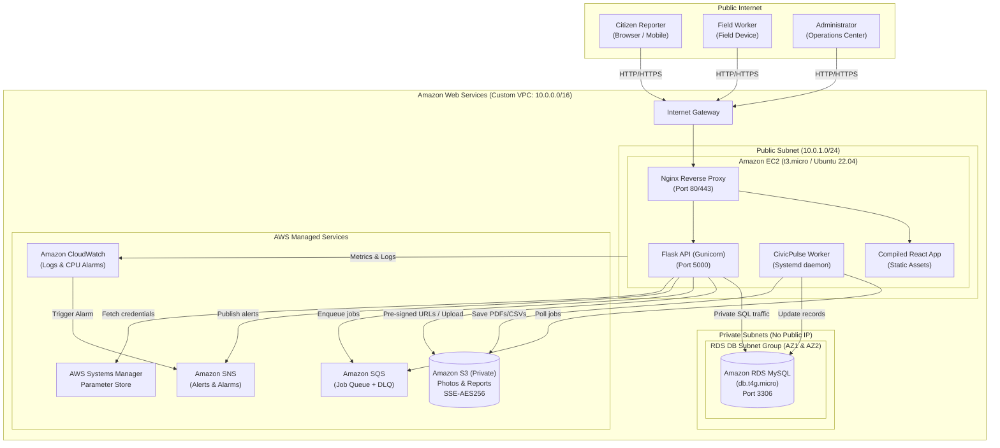

# CivicPulse Architecture Specification

## 1. Architectural Overview

CivicPulse is designed as a hybrid cloud system centered on **Amazon EC2** and **Amazon RDS for MySQL** within a custom **Amazon VPC**, supplemented with managed storage, queuing, and monitoring services. It avoids pure serverless architecture to retain full operational control over backend background workers and database pooling.

### System Architecture Diagram (Mermaid)

---

## 2. AWS Service Justification Table

| AWS Service | Mandatory / Optional | Implemented Purpose in CivicPulse | Reason for Choice & Alternatives Considered |
| :--- | :--- | :--- | :--- |
| **Amazon EC2** | Mandatory | Runs Nginx reverse proxy, Flask API backend, and the continuous SQS background worker. | Mandated compute host. Demonstrates traditional cloud VM lifecycle, systemd management, and custom AMI/user-data configuration. |
| **Amazon VPC** | Mandatory | Defines network boundaries (`10.0.0.0/16`) isolating public web traffic from the database tier. | Enforces security best practices; prevents direct internet exposure of database resources. |
| **Internet Gateway & Route Tables** | Mandatory | Provides controlled bidirectional internet connectivity for the EC2 host. | Standard AWS routing component; route table ensures only public subnet traffic reaches the IGW. |
| **Amazon RDS for MySQL** | Mandatory | Stores issues, categories, assignments, duplicate cluster links, status history, and audit events. | Relational integrity and transactions are critical for SLA tracking and duplicate clustering review. Configured as private single-AZ to stay within Free Tier. |
| **Amazon S3** | Mandatory | Privately stores citizen issue photos and generated CSV/PDF executive summaries. | High durability, encryption at rest (AES-256), and short-lived pre-signed URL capability without public bucket exposure. |
| **AWS IAM** | Mandatory | EC2 instance profile granting least-privilege permissions to S3, SQS, SNS, CloudWatch, and SSM. | Eliminates hard-coded API credentials on the server. |
| **AWS SSM Parameter Store** | Mandatory | Stores database master password and environment configuration as encrypted `SecureString`. | Secrets management without code repository exposure. |
| **Amazon CloudWatch** | Mandatory | Application log aggregation and EC2 CPU threshold alarm (>80%). | Operational observability and alerting required for municipal uptime SLAs. |
| **Amazon SNS** | Mandatory | Dispatches operational alerts for critical safety reports and CloudWatch threshold alarms. | Push notification system capable of sending email alerts to municipal supervisors. |
| **Amazon SQS** | Mandatory | Decouples asynchronous tasks (report rendering, metadata analysis) with automatic Dead Letter Queue (DLQ). | Prevents web request timeouts during large report generation or bursty submission traffic. |
| **AWS CloudFormation** | Mandatory | Modular infrastructure-as-code templates for repeatable environment deployments. | Declarative, version-controlled provisioning. |

---

## 3. Data Flow & Algorithmic Pipelines

### Duplicate Clustering Algorithm
1. When an issue is submitted, the engine queries active, unresolved issues in the same category within the ward or city.
2. **Geospatial Distance:** Computes the great-circle Haversine distance between coordinates ($d \le 0.35\text{ km}$).
3. **Text Overlap:** Evaluates tokenized Jaccard similarity across title and description text.
4. **Composite Similarity:** Weighted formula:
   $$\text{Score} = (0.40 \times \text{Spatial Proximity}) + (0.40 \times \text{Text Similarity}) + (0.20 \times \text{Category Match})$$
5. If $\text{Score} \ge 0.50$, the new report is linked to an existing cluster or initializes a new cluster with `pending_review` status. Both reports remain intact.

### Multi-Factor Priority Scoring
1. **Base Severity:** $1 \le s \le 5$, contributing up to 35 points ($7s$).
2. **Safety Hazard Bonus:** Direct hazard flag adds $+25$ points.
3. **Critical Infrastructure:** Transit or emergency route impact adds $+15$ points.
4. **Cluster Repetition:** Similar reports in cluster add up to $+15$ points ($3 \times \text{duplicates}$).
5. **Aging Factor:** Open issues age past 24 hours add up to $+10$ points.
6. **Total:** Clamped between $0$ and $100$ with an explainable justification string stored directly in the database.
